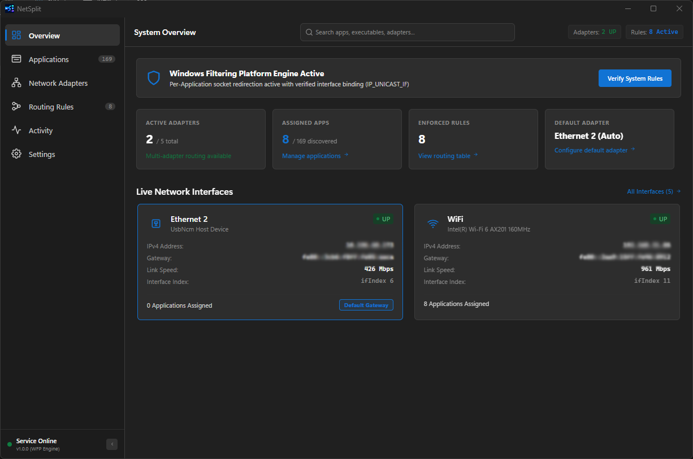
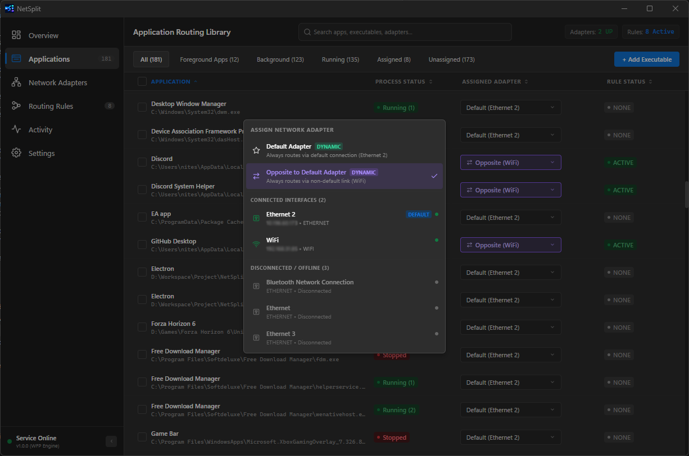
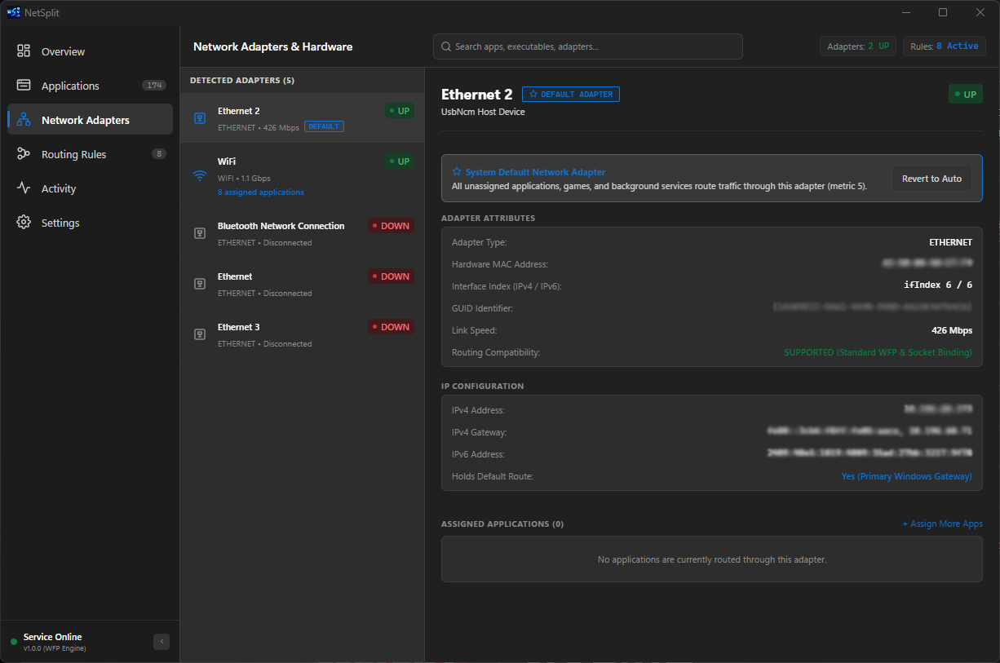
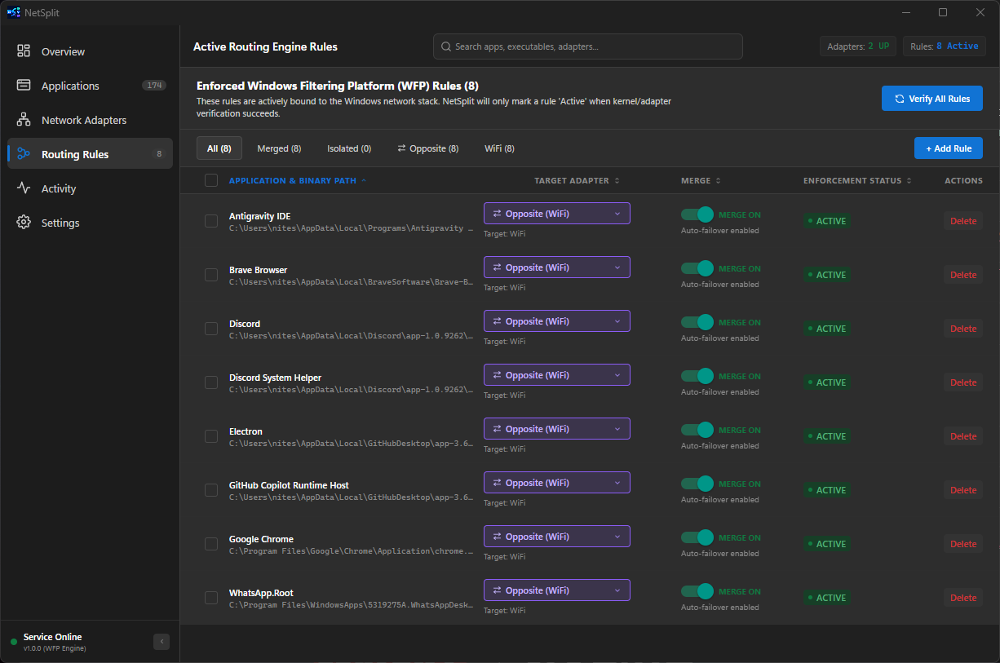
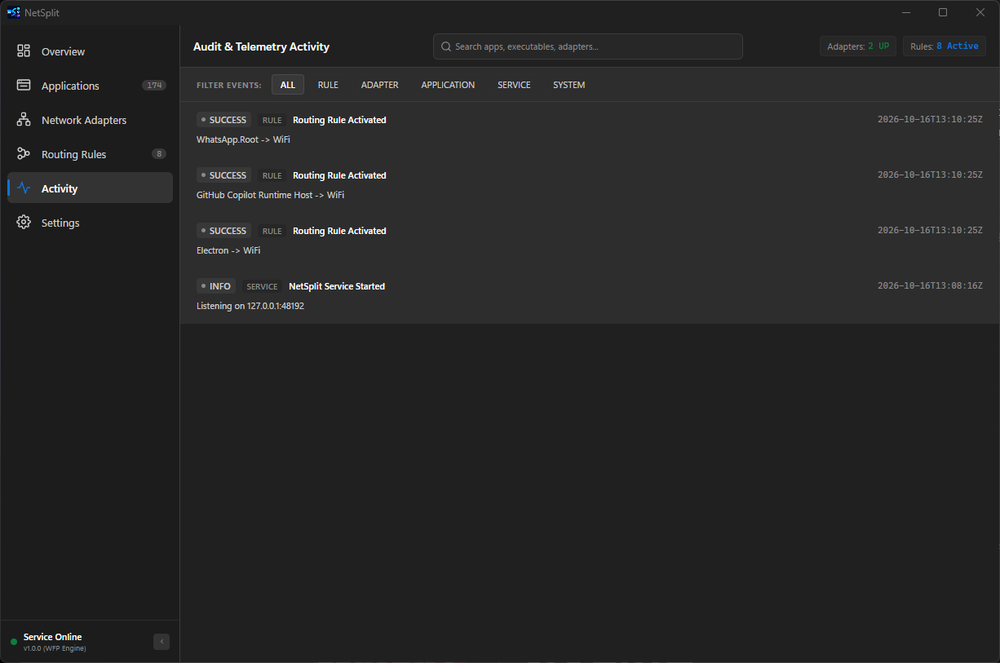
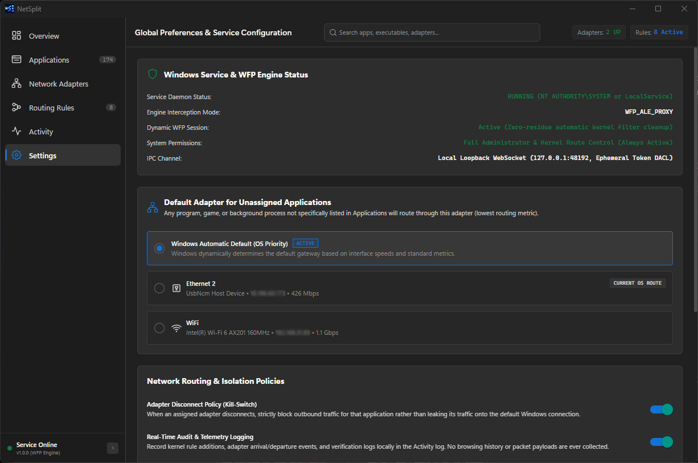
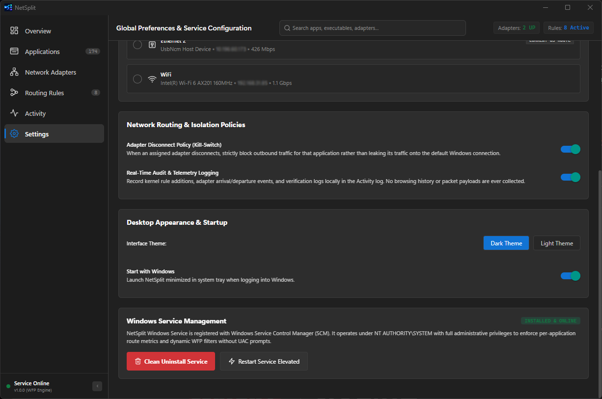

# NetSplit: Per-Application Network Routing for Windows 11

[](https://microsoft.com/windows)
[](https://microsoft.github.io/react-native-windows/)
[](https://learn.microsoft.com/windows/win32/fwp/windows-filtering-platform-start-page)
[](#automated-testing)
[](#core-guarantees)

NetSplit is a high-performance Windows 11 utility designed to bind individual desktop applications, games, and background tasks to specific network adapters (such as Ethernet, Wi-Fi, 4G/5G USB tethering, or secondary network cards) without modifying application binaries, injecting DLLs, or changing the global Windows default routing table.



---

## Primary Use Cases

### 1. Multiplayer Gaming With Low Ping While Live Streaming (Most Popular)
- Scenario: A gamer is streaming on Twitch, YouTube, Kick, or Discord using OBS Studio or Streamlabs while competing in multiplayer games like Valorant, Counter-Strike 2, Apex Legends, Call of Duty, Fortnite, or Rocket League.
- Problem: Live streaming software uploads high-bitrate video streams continuously. When stream uploads share the same network interface as the game, network buffers fill up (bufferbloat), resulting in sudden latency spikes, rubber-banding, packet loss, and jitter that ruin competitive gameplay.
- Solution with NetSplit:
  - Network Adapter A (Low-latency fiber or stable wired Ethernet): Dedicated exclusively to the game executable. The game traffic is prioritized on a clean, uncontended channel, maintaining rock-solid 10 ms to 20 ms in-game ping.
  - Network Adapter B (Secondary Wi-Fi, mobile hotspot, or secondary ISP): Dedicated to OBS Studio, Streamlabs, Twitch chat bots, and streaming encoders. High-throughput video uploads utilize the secondary connection without interfering with game latency.

### 2. High-Speed Game Downloads and Torrents Without Lagging Work or Browsing
- Scenario: Downloading 50 GB to 150 GB game updates on Steam, Epic Games Launcher, Battle.net, or running torrent clients while working, studying, or attending video conferences.
- Problem: Game launchers and BitTorrent clients open hundreds of simultaneous connections and saturate downlink and uplink bandwidth, causing browser timeouts and degrading voice calls on Discord, Zoom, or Microsoft Teams.
- Solution with NetSplit:
  - Route Steam, Epic Games, or torrent clients through a secondary Wi-Fi or high-capacity connection.
  - Keep web browsers, Zoom, and Teams on the primary low-jitter network interface.

### 3. Corporate VPN Isolation for Personal Applications
- Scenario: Working remotely with a required corporate VPN client (such as Cisco AnyConnect, GlobalProtect, or OpenVPN) active on the system.
- Problem: Enterprise VPN policies often route all system traffic through corporate gateways, causing personal traffic (Spotify, YouTube, personal browsers, Discord) to suffer high latency, bandwidth throttles, and workplace monitoring.
- Solution with NetSplit:
  - Assign work-specific tools, SSH clients, and corporate browsers to the VPN virtual network interface.
  - Assign personal browsers, music streaming, and gaming applications to your local physical Wi-Fi or Ethernet adapter, completely bypassing the corporate VPN tunnel.

### 4. Continuous Cloud Backup Without Disrupting Real-Time Tasks
- Scenario: Running continuous background cloud synchronization tools like OneDrive, Google Drive, Dropbox, or Backblaze.
- Problem: Large file syncs and backup uploads trigger upload congestion during working hours, leading to dropped frames during video presentations and stuttering voice chat.
- Solution with NetSplit:
  - Isolate cloud backup services to an auxiliary network adapter or an off-peak cellular connection, preserving full bandwidth on the main connection for real-time applications.

### 5. Multi-ISP Testing and Network Development
- Scenario: Web developers, network engineers, and QA teams validating web services, APIs, and microservices across different Internet Service Providers or routing environments.
- Problem: Testing how an application performs across different ISPs typically requires swapping cables, disabling network adapters, or testing on separate physical machines.
- Solution with NetSplit:
  - Run Browser A or Postman bound to ISP 1 (e.g. Fiber).
  - Run Browser B or curl bound to ISP 2 (e.g. 5G Cellular or Starlink).
  - Test routing, regional CDN delivery, and failover behavior side by side on a single machine.

### 6. Crystal-Clear Voice and Communications Isolation
- Scenario: Participating in critical voice meetings, podcasts, or competitive voice comms via Discord, TeamSpeak, or Zoom.
- Solution with NetSplit:
  - Bind voice communication tools to the most stable physical connection (e.g. wired Ethernet) to guarantee zero dropped voice packets, regardless of what other software is downloading on secondary network adapters.

---

## Core Guarantees

- Zero Binary Tampering: No DLL injection (no AppInit_DLLs, no CreateRemoteThread), no API hooking (no Detours, no MinHook, no Layered Service Providers), and zero byte modifications to application executables.
- Anti-Cheat Safe: Completely transparent to kernel-level anti-cheat engines including Riot Vanguard, Easy Anti-Cheat, BattlEye, and Valve Anti-Cheat (VAC) by operating strictly at the Windows network stack boundary (WFP and socket layer).
- Privilege Isolation: The desktop user interface runs under standard user permissions (Medium Integrity Level). Privileged actions are restricted to an authenticated C++ Windows Service communicating over local loopback (127.0.0.1:48192) using an ephemeral 256-bit authentication token.
- Strict Verifiable State: No simulated indicators. Rule status is validated against live kernel filter state and adapter binding status.
- Strict Exclusive Assignment: Each application is bound to at most one network adapter at any time. Conflicting rules are resolved atomically.
- Safe Fallback Policies: If an assigned network adapter disconnects, applications gracefully fall back to the Windows default connection or hold traffic according to your preference.

---

## Screenshots & Visual Tour

### 1. System Overview Dashboard
Real-time dashboard displaying kernel WFP engine status, active network adapters, enforced routing rules, and live hardware interface metrics.


### 2. Application Routing Library & Quick Selector
Automatic discovery of running foreground applications, background services, and installed software with one-click dynamic routing assignment.



### 3. Network Adapters & Hardware Inspector
Detailed hardware telemetry for all detected adapters, including MAC address, link speed, IPv4/IPv6 gateway configuration, and primary route controls.



### 4. Active Routing Engine Rules
Live monitoring and management of kernel-enforced Windows Filtering Platform rules, with per-rule auto-failover merge mode toggles.



### 5. Audit & Telemetry Activity Log
Real-time diagnostic event feed recording rule activations, service initialization events, and interface connection changes.



### 6. Global Preferences & Engine Status
Verification of kernel driver interception modes, dynamic session security, unassigned application default policies, and adapter disconnect kill-switch controls.



### 7. Desktop Preferences & Service Management
Windows Service lifecycle management controls (elevated restart, clean uninstallation), Windows startup integration, and theme preferences.



---

## System Architecture

```
+-----------------------------------------------------------------------------------+
|                         React Native Windows Desktop UI                           |
|                    (Standard User Privileges - Medium IL)                         |
|                                                                                   |
|  [Overview] [Applications] [Adapters] [Routing Rules] [Activity Log] [Settings]   |
|                                     |                                             |
|                     Zustand Store / Typed JSON-RPC Client                         |
+-------------------------------------|---------------------------------------------+
                                      | JSON-RPC 2.0 over Secure Loopback HTTP
                                      | http://127.0.0.1:48192 (Ephemeral Token Auth)
                                      v
+-----------------------------------------------------------------------------------+
|                           NetSplit Windows Service                                |
|                        (NT AUTHORITY\SYSTEM or Service)                           |
|                                                                                   |
|  +-------------------------+  +--------------------------+  +------------------+  |
|  | IPC Server & Auth Gate  |  | Assignment Manager       |  | App Discovery &  |  |
|  | (127.0.0.1 token auth)  |  | (Exclusive, JSON journal)|  | Running Mon      |  |
|  +-------------------------+  +--------------------------+  +------------------+  |
|                                     |                                             |
|  +------------------------------------------------------------------------------+ |
|  |                        NetSplit Routing Engine                               | |
|  |                                                                              | |
|  |  [Adapter Enumerator]        [WFP ALE Filter Manager]    [Redirect Broker]   | |
|  |  (GetAdaptersAddresses,      (FwpmFilterAdd0,            (IP_UNICAST_IF      | |
|  |   IP Helper, Netlink events)  ALE_CONNECT_REDIRECT)       transparent proxy) | |
|  +------------------------------------------------------------------------------+ |
+-----------------------------------------------------------------------------------+
```

---

## Technical Routing Mechanism

NetSplit uses a two-tier routing mechanism designed specifically for Windows 11:

1. Windows Filtering Platform (WFP) Application Layer Enforcement (ALE):
   - Injects non-intrusive kernel filters into the `FWPM_LAYER_ALE_CONNECT_REDIRECT_V4` layer.
   - Matches outbound socket requests by process image path (e.g. `C:\Games\Game.exe`).
   - Redirects matched connection attempts to an internal loopback broker socket without modifying system routing tables.

2. Socket Interface Binding (IP_UNICAST_IF):
   - The broker socket sets the `IP_UNICAST_IF` option via `setsockopt` with the target network adapter interface index (`ifIndex`).
   - The Windows kernel TCP/IP stack binds the outbound connection directly to the specified physical or virtual network interface.
   - All session filters use dynamic sessions (`FWPM_SESSION_FLAG_DYNAMIC`), ensuring all kernel filters are automatically cleared if the service stops or crashes.

---

## Hardware Feasibility Verification

The dual-interface binding mechanism was verified on live Windows 11 hardware with two concurrent network connections (Wi-Fi 6 AX201 and 4G USB Tethering):

```
====================================================================
   NetSplit: Technical Feasibility Proof of Concept Output          
   Independent Process and Socket-Level Network Interface Binding   
====================================================================

--- Testing Adapter: Ethernet 2 (Index: 6, Local IP: 10.232.65.65) ---
  [SUCCESS] setsockopt(IP_UNICAST_IF, ifIndex=6) applied.
  [BOUND] Local socket endpoint: 10.232.65.65:53372
  ===> RESULT: TCP Traffic successfully routed through adapter [Ethernet 2]!
       Observed Public Egress IP: 47.31.115.112
  [SUCCESS] UDP DNS query to 1.1.1.1 succeeded via Ethernet 2 (Received 61 bytes).

--- Testing Adapter: WiFi (Index: 11, Local IP: 192.168.31.85) ---
  [SUCCESS] setsockopt(IP_UNICAST_IF, ifIndex=11) applied.
  [BOUND] Local socket endpoint: 192.168.31.85:53373
  ===> RESULT: TCP Traffic successfully routed through adapter [WiFi]!
       Observed Public Egress IP: 49.37.73.231
  [SUCCESS] UDP DNS query to 1.1.1.1 succeeded via WiFi (Received 61 bytes).
```

Two concurrent sockets egressed through distinct physical adapters, producing different public IP addresses without modifying the system routing table.

---

## Repository Structure

```
NetSplit/
├── apps/
│   └── desktop/                  # React Native for Windows Desktop Application
│       ├── src/
│       │   ├── components/       # TopBar, Sidebar, StatusBadge, QuickSelector, Modal, Icons
│       │   ├── screens/          # Overview, Applications, Adapters, Rules, Activity, Settings
│       │   ├── services/         # Typed JSON-RPC 2.0 Client (ipcClient.ts)
│       │   ├── store/            # Centralized Zustand State Management (useNetSplitStore.ts)
│       │   └── theme/            # Fluent 2 Color Tokens, Spacing, Typography
│       ├── electron/             # Electron Host, Preload, and Window Management
│       ├── package.json
│       └── tsconfig.json
├── packages/
│   └── shared-types/             # Shared TypeScript Contracts & JSON-RPC Schemas
├── native/
│   ├── windows-service/          # C++17 Privileged Windows Service Daemon
│   │   ├── src/
│   │   │   ├── adapter_manager   # GetAdaptersAddresses and Interface Events
│   │   │   ├── app_discovery     # Process and Installed Application Enumerator
│   │   │   ├── assignment_manager# Transactional Exclusive Assignment Store
│   │   │   ├── wfp_routing_engine# WFP Dynamic Engine and Proxy Broker
│   │   │   ├── ipc_server        # Authenticated Loopback JSON-RPC 2.0 Server
│   │   │   └── service_main      # SCM Service and Console Runner Entrypoint
│   │   └── build.bat             # MSVC x64/x86 build script
│   ├── router/                   # Winsock Hooking DLLs (NetSplitRouter.dll / NetSplitRouter32.dll)
│   ├── launcher.cpp              # Native Desktop Executable Launcher (NetSplit.exe)
│   ├── window_helper.cpp         # Native DWM / Win32 Visible Window Helper
│   └── poc-verifier/             # Socket-Level Verification Harness
├── scripts/
│   ├── install-service.ps1       # Elevated Windows Service installer
│   ├── uninstall-service.ps1     # Clean service removal and system recovery
│   ├── elevate-service.ps1       # Elevated service restarter with UAC elevation
│   ├── package-release.ps1       # Standalone distribution packaging script
│   └── verify-routing.ps1        # Real-time multi-adapter routing tester
├── tests/
│   ├── unit/                     # Uniqueness and Protocol validation tests
│   └── integration/              # Live service daemon and IPC tests
├── docs/
│   ├── architecture.md           # Subsystem architecture and packet path
│   ├── security.md               # Threat model, IPC DACL, anti-cheat safety
│   ├── routing-limitations.md    # Multi-process and VPN boundaries
│   ├── installation.md           # Developer setup and service commands
│   └── routing-engine-feasibility-report.md # Feasibility experimental report
├── visuals/                      # Application Screenshots & UI Documentation
│   └── v1.0.0/                   # Visual walkthrough assets for v1.0.0 release
├── NetSplit.exe                  # Native Application Executable
├── Launch-NetSplit.bat           # Desktop Application Batch Launcher
└── README.md
```

---

## Getting Started

### 1. Compile Native Components
Build the native C++ routing service and helper libraries:
```powershell
cmd.exe /c "native\windows-service\build.bat"
```

### 2. Run Automated Verification Tests
Run the complete automated test suite (18 unit and integration tests):
```powershell
npm test
```

### 3. Launch the NetSplit Desktop GUI
You can launch the desktop application in any of the following ways:
- Double-click `NetSplit.exe` in the project root directory.
- Double-click `Launch-NetSplit.bat`.
- From the command line:
  ```powershell
  npm start
  ```

### 4. Install the Windows Service (On Demand)
When opening NetSplit for the first time or after uninstallation, the app runs cleanly in offline mode without auto-installing or forcing background processes:
- From Overview: Click the prominent **Install Windows Service** button on the Overview card.
- From Settings: Navigate to Settings, locate the Windows Service card, and click **Install as Windows Service**.
- Approve the standard Windows UAC prompt once.
- NetSplit registers the Windows Service with Windows Service Control Manager (SCM), starts it under `NT AUTHORITY\SYSTEM`, connects the secure IPC client, and activates rule enforcement.

### 5. Build Standalone Production Release
To build a clean, self-contained release package ready for distribution:
```powershell
npm run release
```
This automated command:
1. Compiles the native C++ Windows Service daemon and router DLLs with MSVC.
2. Compiles the native `NetSplit.exe` launcher with the custom icon resource embedded.
3. Compiles the production frontend web bundle using Vite.
4. Executes the complete 18-test unit and integration test suite.
5. Packages a clean distribution into `release/NetSplit-v1.0.0-windows-x64/` (sealing all JavaScript inside `runtime/resources/app.asar` and removing loose developer files) and compresses it into `release/NetSplit-v1.0.0-windows-x64.zip`.

---

## Standalone Release Requirements

The packaged distribution in `release/NetSplit-v1.0.0-windows-x64` is completely self-contained and requires no prerequisites:
- Operating System: Windows 10 or Windows 11 (64-bit / x64).
- User Privileges: Standard Windows Administrator rights (prompted via standard UAC on launch to configure routing rules).
- Node.js or npm: Not required. The standalone Electron runtime is bundled in the `runtime/` folder.
- Visual C++ Redistributable: Not required. Native binaries link exclusively to standard Windows system DLLs (`kernel32`, `user32`, `advapi32`, `ws2_32`, `iphlpapi`, `fwpuclnt`, `dwmapi`, `bcrypt`).
- Custom Kernel Drivers: Not required. Routing is performed via Microsoft's built-in Windows Filtering Platform (WFP) and IP Helper APIs.
- Python or Build Tools: Not required. All native binaries and frontend assets are pre-compiled and sealed into `app.asar`.

To run from release:
1. Extract the `NetSplit-v1.0.0-windows-x64.zip` archive or open the release folder.
2. Double-click `NetSplit.exe`.
3. Accept the standard Windows UAC elevation prompt. The desktop interface opens immediately.

---

## Managing Routing Rules

- Foreground Application Detection: The Applications screen uses a native Win32/DWM enumeration helper (`window_helper.exe`) that filters active desktop top-level windows in real time (`DwmGetWindowAttribute` with `DWMWA_CLOAKED`), prioritizing the applications and games you are actively interacting with at the top of the list.
- Comprehensive Application Search: Search by process name, window title, or executable path to route any installed Windows software, game launcher, or background process.
- Adapter Binding: Use the dropdown on each application card to assign it to an adapter or set it to follow the default adapter.
- Quick Assignment: Use the quick selector to bulk-assign multiple applications to a specific connection.
- Top Bar Master Switch: Pause all routing rules instantly with one click. When paused or when the service is offline, all applications automatically revert to standard Windows routing without terminating sessions.
- Dynamic Merge Mode: When utilizing the Opposite Default routing rule, the Merge toggle lets you automatically aggregate available interfaces if the secondary connection is disconnected.

---

## Windows Service Lifecycle and Dynamic Management

NetSplit provides dynamic service state awareness in the Settings screen:

- Dynamic SCM Detection: NetSplit queries Windows Service Control Manager in real time to determine whether the background service is registered.
- Dynamic Interface Controls:
  - When Installed: Displays an `INSTALLED & ONLINE` (or `INSTALLED (STOPPED)`) badge, the red **Clean Uninstall Service** button, and the **Restart Service Elevated** button. The install button is hidden.
  - When Not Installed: Displays a `NOT INSTALLED` badge with the blue **Install as Windows Service** button. Uninstallation and restart buttons are hidden.
- Silent System Service Execution: The service daemon runs under `NT AUTHORITY\SYSTEM` in Session 0, starting with Windows boot without spawning visible command prompt windows or console popups.
- Desktop App Startup: The **Start with Windows** toggle configures the desktop GUI application (`NetSplit.exe`) to launch minimized to the system tray on user logon via Windows login item settings.

---

## Clean Uninstallation and System Recovery

NetSplit leaves zero residue in the Windows kernel or system configuration. When uninstalled:
- All dynamic WFP filters are automatically released by the kernel (`FWPM_SESSION_FLAG_DYNAMIC`).
- The Windows Service entry is removed from the Service Control Manager (`sc.exe delete NetSplitService`).
- Temporary IPC authentication tokens are purged.
- Interface metric configurations are restored to Windows automatic defaults.
- The UI immediately normalizes back to the uninstalled state without delay.

To uninstall:
- From the Desktop UI: Navigate to Settings, locate the Windows Service card, click **Clean Uninstall Service**, and confirm in the modal.
- From PowerShell (Administrator):
  ```powershell
  powershell -ExecutionPolicy Bypass -File .\scripts\uninstall-service.ps1
  ```

---

## License

Licensed under the MIT License.
